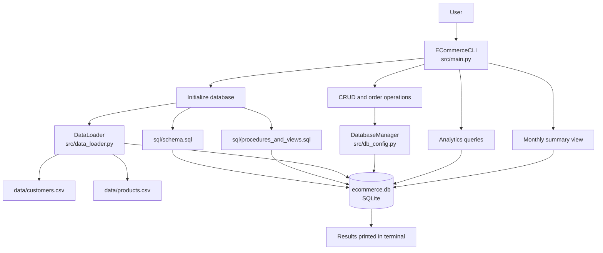
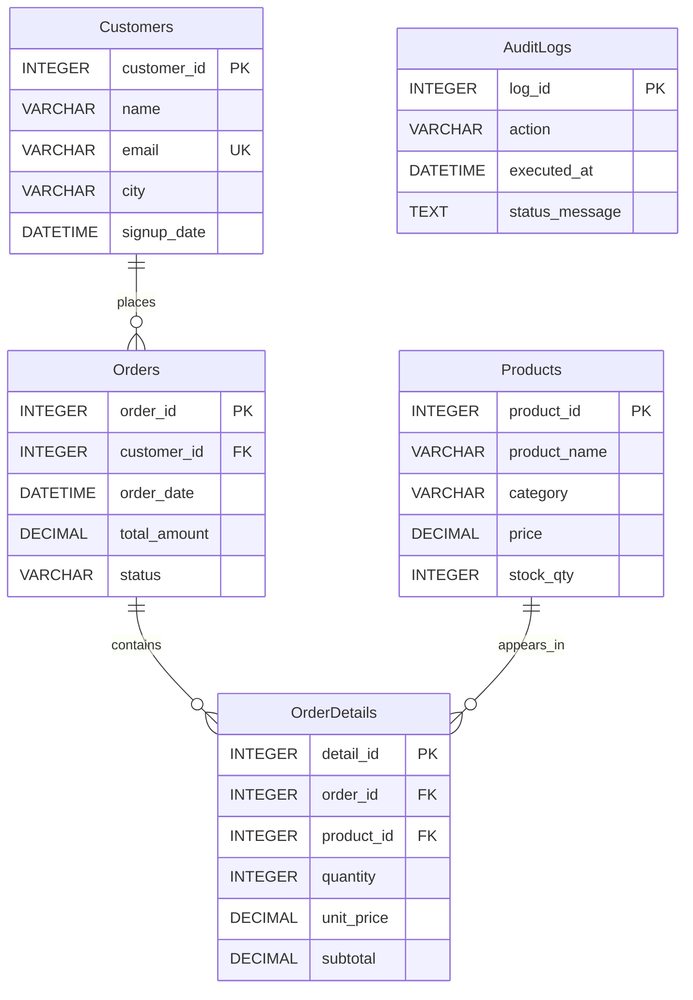

# E-Commerce Analytics Engine

A Python command-line application for managing sample e-commerce data and running SQL analytics against a local SQLite database. It demonstrates CSV ingestion, relational data modeling, CRUD operations, order transactions, audit logging, SQL views, and analytical queries.

## Overview

The application initializes a SQLite database from SQL scripts, imports customers and products from CSV files, and presents an interactive terminal menu for managing data and viewing reports.

It is intended for learning, demonstrating, or prototyping relational database concepts. It is not a production commerce backend: it does not include a web API, authentication, payment processing, or deployment configuration.

## Features

- Creates the database schema, foreign keys, constraints, and indexes.
- Imports customer and product records from CSV files.
- Supports adding customers, viewing inventory, updating stock, and deleting orders.
- Places orders in a transaction that updates inventory and records order details.
- Writes audit records for selected operations and failed orders.
- Runs SQL reports demonstrating filtering, aggregation, joins, CTEs, and window functions.
- Displays a monthly order summary through a SQLite view.

## Architecture

The application separates terminal workflows, database connection management, CSV ingestion, and SQL definitions.



### Data model



`Customers` and `Products` are the source entities. An `Orders` row belongs to a customer, and `OrderDetails` connects an order to its products. `AuditLogs` records selected application events.

## Project Structure

```text
ecommerce_analytics_engine/
├── data/
│   ├── customers.csv
│   └── products.csv
├── sql/
│   ├── analytics_queries.sql
│   ├── procedures_and_views.sql
│   └── schema.sql
└── src/
    ├── data_loader.py
    ├── db_config.py
    └── main.py
```

| Path | Responsibility |
|---|---|
| `src/main.py` | Application entry point, interactive menu, CRUD workflows, order processing, audit display, and report output. |
| `src/db_config.py` | Creates and manages the SQLite connection, enables foreign keys, and executes SQL scripts. |
| `src/data_loader.py` | Reads customer and product CSV files, converts values, and inserts rows into the database. |
| `sql/schema.sql` | Defines tables, constraints, foreign keys, and indexes. |
| `sql/procedures_and_views.sql` | Defines the `vw_monthly_summary` view. It also includes a commented DCL example; no stored procedure is defined. |
| `sql/analytics_queries.sql` | Contains example queries for filtering, aggregation, joins, CTEs, and window functions. |
| `data/customers.csv` | Seed customer records. |
| `data/products.csv` | Seed product records, including prices and inventory quantities. |

The SQLite database file, `ecommerce.db`, is created at runtime in the process's current working directory by default.

## Technology Stack

- **Python** for the CLI and application logic.
- **SQLite** for local relational storage.
- **Python standard library** modules: `sqlite3`, `csv`, `os`, and `datetime`.
- **SQL** for schema definitions, views, and analytics queries.

No third-party Python packages are required by the files in this project.

## Database Schema

The schema defines five tables:

- **Customers**: Customer name, unique email, city, and signup date.
- **Products**: Product name, category, price, and stock quantity.
- **Orders**: Customer, order date, total amount, and status.
- **OrderDetails**: Product, quantity, unit price, and subtotal for an order.
- **AuditLogs**: Action name, timestamp, and status message.

Constraints include required fields, a unique customer email, positive product prices, nonnegative stock, positive order-detail quantities, and foreign-key relationships. Indexes are created for order customer IDs and product categories.

SQLite foreign-key enforcement is enabled when the application creates its database connection.

## Analytics

`sql/analytics_queries.sql` includes examples of:

1. Filtering products by category, price range, and product name.
2. Grouping products by category and filtering groups with `HAVING`.
3. Joining orders with customers.
4. Using a CTE to aggregate order revenue by customer city.
5. Using window functions to rank products by price within each category and calculate category-level price totals.

The `vw_monthly_summary` view groups orders by month and calculates order count, distinct buyers, and total order revenue.

The included CSV files seed customers and products, but not orders. Order-based reports therefore return no sales results until orders have been placed through the application.

## Setup and Usage

### Prerequisites

- Python 3 installed and available on your `PATH`.

### Run the application

From the project root directory:

```powershell
python -m src.main
```

The application initializes the schema and view, loads the CSV data, and displays the CLI menu.

Run it from the project root because the application currently uses relative paths such as `sql/schema.sql` and `data/customers.csv`.

### Menu options

```text
1. Insert User
2. View Inventory
3. Update Stock
4. Delete Order
5. View Audit Logs
6. Place Order
7. Run Analytics Queries
8. View Monthly Summary
9. Exit
```

## Execution Lifecycle

1. `src/main.py` creates an `ECommerceCLI` instance and starts the application.
2. The application executes `sql/schema.sql` and `sql/procedures_and_views.sql`.
3. `DataLoader` imports customer and product rows from the CSV files.
4. The CLI prompts for an operation.
5. The selected method executes SQL against the shared SQLite connection.
6. For order placement, the application checks product availability, decrements inventory, inserts an order and its details, and commits the changes together.
7. Analytics operations execute the SQL statements from `sql/analytics_queries.sql` and print returned rows.
8. The monthly summary operation queries `vw_monthly_summary`.
9. Selecting Exit closes the database connection.

## Configuration

The project does not currently require environment variables.

Configuration is provided by constructor defaults:

- `DatabaseManager(db_path="ecommerce.db")` selects the SQLite database path.
- `DataLoader(..., data_dir="data")` selects the CSV data directory.
- SQL scripts are loaded from the relative `sql/` directory.

Because these paths are relative, the working directory affects where the database is created and whether the input files are found.

## Design Notes

- CSV rows are converted into tuples and inserted in batches with `executemany`.
- Seed inserts use `INSERT OR IGNORE`, so conflicting rows may be silently skipped.
- Order placement uses an explicit transaction so inventory, order, order details, and the success audit entry are committed or rolled back together.
- Failed order attempts are logged using a separate SQLite connection after the main transaction rolls back.
- Tables, indexes, and the view use `IF NOT EXISTS` to make initial setup repeatable.

## Limitations and Potential Improvements

- **Input validation:** Quantities and stock updates should be validated before executing SQL. Invalid numeric input can raise an exception, and zero or negative order quantities are not rejected by the CLI up front.
- **Error handling:** Several CRUD operations do not catch database errors such as duplicate emails, invalid foreign keys, or negative stock.
- **Concurrent orders:** Stock is read and then updated separately. A conditional update that checks available stock as part of the update would better protect against competing order attempts.
- **Financial precision:** Python `float` values are used for product prices. Integer minor units or a carefully managed decimal representation are more suitable for financial calculations.
- **Analytics parsing:** The analytics runner splits SQL text on semicolons. This is fragile if future SQL contains semicolons in strings or comments.
- **Relative paths:** Paths depend on launching the application from the project root. Resolving paths relative to the source or project directory would make startup more robust.
- **View semantics:** The monthly summary currently includes all orders, regardless of status, despite the CLI wording referring to completed orders.
- **Import visibility:** `INSERT OR IGNORE` can hide data conflicts. Reporting skipped rows and validation failures would make imports easier to troubleshoot.
- **Testing and migrations:** No automated tests or schema migration mechanism are included in the provided project structure.
- **Production readiness:** Authentication, authorization, privacy controls, backup strategy, structured logging, monitoring, and deployment configuration are outside the current implementation.

## License

No license file is included in the provided project structure.
